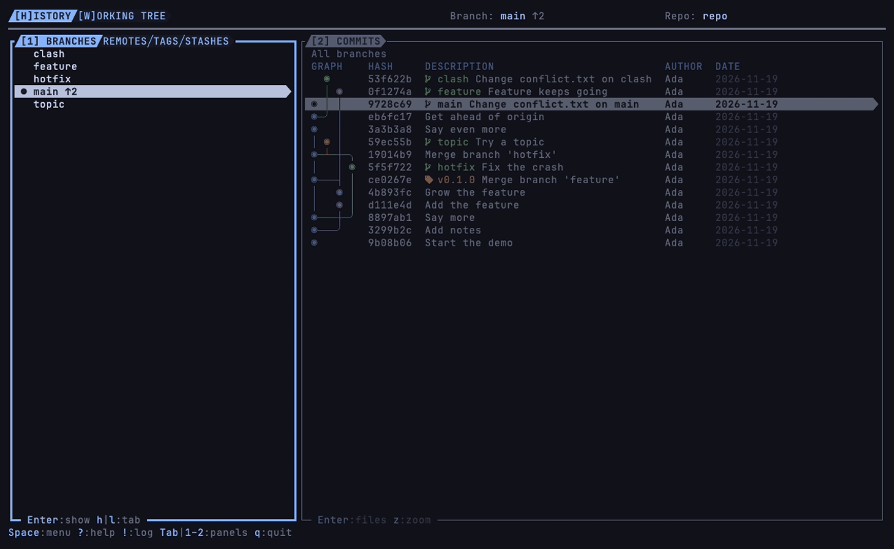

# gittu

[](https://github.com/vulcanshen/gittu/releases)
[](LICENSE)

**Language**: [English](README.md) · 繁體中文

**終端機的 git 工具：左邊是分支，右邊是分支圖，能做的事都在 `Space` 選單裡。**

在 repo 裡打 `gittu`，打開一個有五個面板的畫面：左邊上面是要 commit 的檔案，下面是本地分支、遠端分支、tag 與 stash；
右邊是 commit 與分支圖，下面是 cursor 那個 commit 的訊息與它改了的檔案。移到要 commit 的檔案上時，右邊換成 cursor 那個檔的
差異與改過它的 commit。對 cursor 那個檔、分支或 commit 能做的事都在 `Space` 選單裡，對整個 repo 的動作在 global operation 裡。看一個 commit 改了哪些檔、
每個檔的差異，比較兩個 commit，stage、commit、merge，用你自己的 editor 解衝突 —— 不用先背任何熱鍵。



## 特色

- **分支與分支圖並排**：左邊是本地分支、遠端分支、tag 與 stash，右邊是 commit 與分支圖；cursor 移到分支上，分支圖就跳到它的
  commit，按 `Enter` 就過去。
- **看得懂的分支圖**：一個 commit 一列，每條線一個顏色，`[3]` 放得下幾條線就畫幾條，分支與 tag 標在它們的 commit 上；CURRENT 分頁把 `[2]` cursor 所在的分支那條
  固定在最左邊，ALL 分頁是 main 那條；遠端分支要看時才畫。
- **先看再動手**：一個 commit 的檔案標上 `+` `-` `~`，就在分支圖下面、跟著 cursor 換，再左右對照看每個檔的兩個版本；兩個 commit 也一樣這樣比。
- **所有操作都在 `Space` 選單**：checkout、merge、rebase、cherry-pick、revert、reset、開分支、打 tag、改名、刪除、stash、
  fetch、pull、push —— 需要先問的，執行前會先問。
- **要 commit 的檔案**：衝突、已經 stage、還沒 stage 的檔案，在分支上面；移到它們上，右邊就是 cursor 那個檔的差異與改過它的 commit；stage、unstage、捨棄改動、commit。
- **用你自己的 editor 解衝突**：在有衝突的檔上按 `Enter` 到 `[3]`，再按 `Enter` 用 git 設定的 editor 打開；離開 editor 後，
  gittu 會告訴你哪幾行還有衝突標記，`r` 把它標成已解決（標記的那些從 `Space` 選單）。也可以一塊一塊選用我的、用對方的或兩個都要。
  merge、rebase、cherry-pick、revert 做到一半時可以放棄或繼續。
- **用你自己的 git**：gittu 呼叫你裝的 git，hooks、credential helper、ssh 金鑰與設定都跟在 shell 裡一樣。

## 安裝

### 需求

- macOS 或 Linux（WSL 也可以）。
- `PATH` 上有 git。
- 終端機用 [Nerd Font](https://www.nerdfonts.com)：圖示與框線都是 Nerd Font 的字。
- 支援 truecolor（24-bit）的終端機：256 色下分不出淡化的顏色與層色。
- 終端機至少 60 欄寬、24 列高；比這小時 gittu 只顯示名稱、需要的大小與怎麼離開，視窗拉大後回到原本的樣子。

gittu 啟動時會量 icon 與 powerline 符號各佔幾格。量錯時可以自己指定：

| 變數 | 指定什麼 |
|---|---|
| `GITTU__ICON_WIDTH` | icon 佔幾格，只給 gittu |
| `GITTU__POWERLINE_WIDTH` | powerline 符號佔幾格，只給 gittu |
| `TERMINU__ICON_WIDTH` | icon 佔幾格，terminu 家族每個 app 共用：設一次，每個 app 都讀得到 |
| `TERMINU__POWERLINE_WIDTH` | powerline 符號佔幾格，terminu 家族每個 app 共用 |

在家族 app 的終端機裡跑時，外層的 app 會替 gittu 設好 `TERMINU__` 這兩個。

### Homebrew

```sh
brew install vulcanshen/tap/gittu
```

### 安裝腳本

```sh
curl -fsSL https://raw.githubusercontent.com/vulcanshen/gittu/main/install.sh | sh
```

不用 sudo：裝到 `~/.local/bin`。

### 第一次啟動

`gittu` 打開目前目錄所在的 repo；`gittu <路徑>` 打開那個路徑所在的 repo。不在 repo 裡時說一聲就結束。只有你執行操作時，
gittu 才會改動你的 repo；它自己只寫 `state.yaml`，而且只在你調左右寬度的時候（見「設定與資料」）。

### 更新

```sh
gittu update
```

照當初安裝的方式更新到最新的正式版：Homebrew 裝的用 Homebrew 更新，安裝腳本裝的直接換成新版。

### 移除

```sh
brew uninstall gittu
```

用安裝腳本裝的：

```sh
curl -fsSL https://raw.githubusercontent.com/vulcanshen/gittu/main/uninstall.sh | sh
```

## 快速開始

```sh
cd your-repository
gittu
```

用 `j`、`k` 移動，按 `Space` 看對 cursor 那個分支或 commit 能做什麼；cursor 那個 commit 改了哪些檔，就列在分支圖下面。`Tab` 換到下一個
面板，`1` 到要 commit 的檔案（右邊跟著換成它們的差異；`s` stage 或 unstage 一個檔），`2` 回到分支與分支圖。`z` 把一個面板放大到整個
畫面，`<`、`>` 調左右的寬度。`?` 列出所有按鍵，`q` 離開。

## 使用方式與按鍵

最下面一列一直寫著 `Space:menu ?:help !:log`：`Space` 列出在這裡能做的事，`?` 列出按鍵，`!` 打開 App Log，看 gittu 做了什麼、
哪裡出錯。

左邊上面是 `[1]` CHANGES，要 commit 的檔案，下面是 `[2]` BRANCHES；`[1]` 的第一列平常寫 All changes，merge、rebase、
cherry-pick、revert 做到一半時寫它，git 在跑時寫在做什麼（Pushing…）。右邊的 `[3]`、`[4]`、`[5]` 跟著 `[1]`、`[2]` 裡你最後待的那一個換：最後在 `[2]`，是 commit 與
分支圖，加上 cursor 那個 commit 的訊息與檔案；最後在 `[1]`，是 cursor 那個檔的差異，加上改過它的 commit，`[5]` 收起來。移到
`[3]`、`[4]`、`[5]` 裡不會換。

`<`、`>` 把左右中間那條線往箭頭的方向移兩欄，focus 在哪一塊 panel 都一樣。gittu 會照終端機的寬度記住你調到哪裡，下次在一樣寬
的終端機打開就照記下的排；沒調過的寬度，左邊是三分之一。左邊至少留 20 欄、右邊至少 40 欄，所以 60 欄寬時那條線不會動。

### 分支與分支圖

| 在哪裡 | `Enter` | `Space` 選單裡 |
|---|---|---|
| `[2]` BRANCHES：本地分支 | 到 `[3]` 它的 commit | `[c]`heck out、`[M]erge` 進目前的分支、把目前的分支 Re`[b]`ase 到它上面、`[r]`ename、`[x]` Delete、Push |
| `[2]` REMOTES：遠端分支 | 到 `[3]` 它的 commit；沒有對應的本地分支時，先 checkout 成本地分支 | `[c]`heck out 成追蹤它的本地分支、`[M]erge`、Re`[b]`ase、`[x]` Delete 遠端的分支 |
| `[2]` TAGS：tag | 到 `[3]` 它的 commit | `[c]`heck out（HEAD 會 detached）、`[x]` Delete、Push |
| `[2]` STASHES：stash | 它存的檔案，跟 commit 一樣 | `[a]`pply、P`[o]`p、`[x]` Drop |
| `[3]` commit | 到 `[5]` 它改了的檔案 | 跟另一個 commit `[D]`iff、`[c]`heck out、`[b]`ranch here、`[t]`ag、`[M]`erge、Rebase、Cherry-pick、Revert、Reset 到這裡、Cop`[y]` hash |
| `[3]` 整個 panel | | `[n]`ext／`[N]` Previous commit（只在 CURRENT 分頁：最左邊那個分支走得到的 commit）、Show／Hide remote branches、`[z]`oom、`[/]` 篩選 |
| `[5]` FILES：檔案 | 它的兩個版本 | `[/]` 篩選 |

`[2]` 有 BRANCHES、REMOTES、TAGS、STASHES 四個分頁，用 `h`、`l` 切換。分支圖畫全部的本地分支與 tag。`[3]` 有兩個分頁，用 `h`、`l` 切換：
CURRENT（打開時在這裡）把 `[2]` cursor 所在的分支、遠端分支或 tag 那條固定在最左邊，`[2]` 移動時跟著換；ALL 把 main（或 master）
那條固定在最左邊。遠端分支一開始只畫本地分支追蹤的或同名的那些，在 `[3]` 的 `Space` 選單選 Show remote branches 才全部畫出來。在 `[3]` 上按 `z` 放大到整個畫面，再按一次還原。upstream 在遠端被刪掉的分支，後面寫 `upstream gone`。

`[4]` DESCRIPTION 是 `[3]` cursor 那個 commit 完整的訊息（在那裡按 `z` 放大到整個畫面），旁邊的 `[5]` FILES 列出它對上一個 commit 改了的檔案，cursor 一動兩個都跟著換：`+` 新增、`-` 刪除、`~` 修改（改名是
`~ 舊 → 新`）。在 commit 上按 `Enter` 會到 `[5]`，在檔案上按 `Enter`，左右對照打開它的兩個版本，UNIFIED 或 SPLIT（`h`、`l` 切換）。
在一個 commit 上按 `D` 進入 Diff 模式，這個 commit 是基準，`[3]`、`[5]` 一起在模式裡：移到另一個 commit，`[5]` 就列出這兩個之間
有差異的檔案。按 `Enter` 到 `[5]`，在檔案上按 `Enter` 一樣這樣打開；`Esc` 照來的路退回，在 `[3]` 上按就離開模式。

### 要 commit 的檔案

| 在哪裡 | `Enter` | `Space` 選單裡 |
|---|---|---|
| 還沒 stage 的檔 | 到 `[3]` 看它的差異 | `[s]`tage、`[m]`ark、Discard、Remove、Ignore |
| 已經 stage 的檔 | 到 `[3]` 看它的差異 | Un`[s]`tage、`[m]`ark、Discard、Remove、Ignore |
| 有衝突的檔 | 到 `[3]`，在那裡按 `Enter` 用 editor 改、`[r]` 標成已解決 | `[m]`ark、Mark `[r]`esolved、Resolve one by one、整個檔 Use mine、Use theirs |
| 一塊衝突 | 到 `[3]` 讀完整的內容 | Use `[m]`ine、use `[t]`heirs、use `[b]`oth |
| 整個 panel | | 有標記時：對標記的檔 stage、unstage、用我的、用對方的、mark resolved、`[X]` discard、remove、ignore；`[M]`ark all（再按一次是 unmark all）、Clear marks、Stage `[a]`ll（再按一次是 unstage all） |
| `[4]` HISTORY：commit | 那個檔在這個 commit 的兩個版本 | `[/]` 篩選 |

用 `m` 標記幾個檔，就能一起處理：`Space` 選單會列出能對標記的檔做的事，每一個只作用在適用的檔上。Remove 刪掉檔案並把刪除
stage 起來；Ignore 把檔案加進 `.gitignore`，git 原本有追蹤的就停止追蹤。

`[1]` 是 CHANGES，`[3]` 是 DIFF：cursor 那個檔改了什麼，畫法跟比較一樣（只畫有差異的段落、兩欄行號）：已經 stage 的是 HEAD 對 index，
還沒 stage 的是 index 對工作區。在那裡按 `Enter` 打開比較本身，UNIFIED 或 SPLIT。`[4]` HISTORY 列出改過那個檔的 commit，新的在前
（還沒 commit 的改名，照舊的名字找）；在 commit 上按 `Enter`，打開那個檔在這個 commit 的兩個版本。

### 整個 repo 的動作

每個 `Space` 選單裡的 `Global operation`，列出對整個 repo 的動作：`[c]`ommit、Amend、`[p]`ull、Pull all（每個 remote 都 fetch，再 pull 目前的分支）、`[P]`ush、`[f]`etch、
在 HEAD `[b]`ranch、`[M]`erge 一個分支、在 HEAD 打 `[t]`ag、`[S]`tash、Discard all、`[R]`efresh；merge、rebase、cherry-pick、
revert 做到一半時，還有 `[A]`bort 與 Continue。這些鍵在 panel 上也能直接按，panel 自己用了同一個鍵時以 panel 的為準：在 `[2]`、`[3]` 上 `c` 是 checkout，Commit 從 global operation 執行；在 `[2]` 上 `b` 是 rebase，Branch 從 global operation 執行；在 `[1]` 上 `t`、`b` 是解衝突區塊用的，在檔案清單上按了不作用。調左右寬度的 `[<]` Narrow the left 與 `[>]` Widen the left 也在這裡。

gittu 每 3 秒重新讀一次 repo，在外面改了東西，畫面也會跟著變，App Log（`!`）會寫出改了什麼。

## 疑難排解

- **push、pull 要密碼**：gittu 沒辦法問密碼，git 會失敗並說明原因。請用 ssh agent，https 的話用 credential helper。
- **commit 被 hook 擋下**：蓋在 commit 表單上的錯誤訊息寫了原因，hook 印的全文在 App Log（`!`）；關掉錯誤訊息，寫好的訊息還在表單裡，可以再 commit 一次。

## 設定與資料

gittu 沒有資料與快取。設定是 `$XDG_CONFIG_HOME/gittu`（或 `~/.config/gittu`；`GITTU__CONFIG` 指定別的目錄）裡的
`config.yaml`。gittu 不會自己建它；沒有這個檔時用預設值。

```yaml
input_tab_width: 4   # commit 訊息裡按 Tab 插入幾個空白，差異裡的 Tab 也畫成這麼寬
```

這是 terminu 家族每個 app 共用的 key。讀不了的 `config.yaml`，gittu 會問要不要移到 `config.yaml.bak`，不要就離開；值不是
大於 0 的整數時，原本的檔留在 `config.yaml.bak`，值改回 4。gittu 不讀的 key（例：打錯字）留在檔案裡，每次啟動 App Log（`!`）會寫出來。

狀態是同一個目錄裡的 `state.yaml`（`GITTU__STATE` 指定別的目錄）：用 `<`、`>` 調過的每一種終端機寬度，左邊各是幾欄。每按一次
就寫一次；刪掉它，每一種寬度都回到三分之一。

```yaml
left:
  77: 25    # 終端機 77 欄寬時，左邊 25 欄
  155: 60
```

讀不了的 `state.yaml` 跟 `config.yaml` 一樣會問要不要移開；gittu 用不了的那一筆，原本的檔留在 `state.yaml.bak`，那一筆從檔案裡拿掉。

## 限制

- 分支圖只讀最新的 1000 個 commit，`[4]` 一個檔的歷史也是。
- `[4]` 一個檔的歷史只照它的路徑找：停在把檔案改名的那個 commit。
- gittu 沒辦法問密碼或 passphrase：請用 ssh agent 或 credential helper。
- 衝突只顯示我的與對方的，不顯示共同的祖先。
- 沒有互動式 rebase、submodule、worktree、git-flow。
- 只有 macOS 與 Linux（WSL 也可以），沒有 Windows 版。

## 相關連結

- [CHANGELOG](CHANGELOG.md)

## terminu family

gittu 遵循 terminu design：

- [terminu design](https://github.com/vulcanshen/terminu)：家族的設計規範
- [terminu-go](https://github.com/vulcanshen/terminu-go)：gittu 用的 Go 函式庫
- [terminu-harness](https://github.com/vulcanshen/terminu-harness)：照 terminu design 做 app 的 Claude Code plugin

## License

[GPL-3.0](LICENSE)
