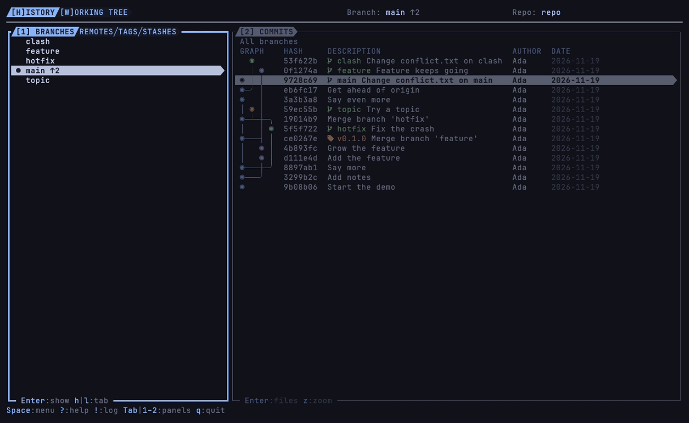

# gittu

[](https://github.com/vulcanshen/gittu/releases)
[](LICENSE)

**Language**: English · [繁體中文](README-zh_TW.md)

**A git client for the terminal: the branches beside the history graph, everything you can do in the `Space` menu.**

`gittu` in a repository opens three panels: the branches, remote branches, tags and stashes on the left, the commits
and their graph on the right, and under them the files of the commit under the cursor. What you can do with the branch or the commit under the cursor is in the `Space` menu,
and what works on the whole repository is in its global operations. Look into a commit's files and their diffs,
compare two commits, stage and commit, merge, and resolve conflicts one block at a time with both sides in sight — with
no keys to learn first.



## Features

- **Branches beside the graph**: the branches, remote branches, tags and stashes on the left, the commits and their graph on
  the right; the cursor on a branch takes the graph to its commit, and `Enter` goes there.
- **A graph you can read**: one row a commit, each line of history in its own colour, as many lines drawn as `[2]`
  has room for, the branches and tags on their
  commits; on the CURRENT tab the line of the branch under `[1]`'s cursor kept on the left, on the ALL tab main's,
  the remote branches only when you want them.
- **Look before you act**: a commit's files marked `+` `-` `~`, right under the graph and following its cursor, then a
  file's two versions side by side; two commits compared the same way.
- **Every operation from the `Space` menu**: check out, merge, rebase, cherry-pick, revert, reset, branch, tag, rename,
  delete, stash, fetch, pull, push — each with the question it needs before it runs.
- **Working tree**: the conflicts, the staged and the unstaged files, the diff of the one under the cursor beside them;
  stage, unstage, discard and commit.
- **Conflicts one block at a time**: mine above theirs, both in sight; use mine, theirs or both, and the file is staged
  when the last block is done. Abort or continue a merge, rebase, cherry-pick or revert.
- **Your git**: gittu runs the git you have, so your hooks, credential helper, ssh keys and settings work as they do
  in the shell.

## Install

### Requirements

- macOS or Linux (WSL too).
- git on your `PATH`.
- A [Nerd Font](https://www.nerdfonts.com) terminal profile: the icons and the frames are Nerd Font glyphs.
- A truecolor (24-bit) terminal: the faded colours and the layer colours cannot be told apart in 256 colours.
- A terminal at least 60 columns wide and 32 rows high; in a smaller one gittu shows only its name, the size it needs
  and how to quit, and comes back as it was once the terminal grows.

gittu measures how many cells an icon and a powerline symbol take when it starts. When it gets them wrong, set them:

| Variable | What it sets |
|---|---|
| `GITTU__ICON_WIDTH` | The cells an icon takes, for gittu |
| `GITTU__POWERLINE_WIDTH` | The cells a powerline symbol takes, for gittu |
| `TERMINU__ICON_WIDTH` | The cells an icon takes, for every terminu family app: set it once and they all read it |
| `TERMINU__POWERLINE_WIDTH` | The cells a powerline symbol takes, for every terminu family app |

Run inside a family app's terminal, gittu gets the `TERMINU__` ones from the app around it.

### Homebrew

```sh
brew install vulcanshen/tap/gittu
```

### Script

```sh
curl -fsSL https://raw.githubusercontent.com/vulcanshen/gittu/main/install.sh | sh
```

No sudo: it installs to `~/.local/bin`.

### The first start

`gittu` opens the repository the current directory is in; `gittu <path>` opens the one `<path>` is in. Outside a
repository it says so and quits. gittu writes nothing of its own: it changes your repository only when you run an
operation.

### Uninstall

```sh
brew uninstall gittu
```

Installed with the script:

```sh
curl -fsSL https://raw.githubusercontent.com/vulcanshen/gittu/main/uninstall.sh | sh
```

## Quick start

```sh
cd your-repository
gittu
```

Move with `j`/`k`, press `Space` to see what you can do with the branch or commit under the cursor; the files of the
commit under the cursor are below the graph. `Tab` goes to the next panel, `W` to the working tree, `H` back to the history. `?` lists every key, `q`
quits.

## Usage

The bottom line always shows `Space:menu ?:help !:log`: `Space` lists what you can do where you are, `?` the keys, `!`
the App Log, what gittu did and what went wrong.

### History

| Where | `Enter` | In the `Space` menu |
|---|---|---|
| `[1]` BRANCHES: a branch | Its commit in `[2]` | `[c]`heck out, `[M]erge` into the current branch, Re`[b]`ase the current branch onto it, `[r]`ename, `[D]`elete, Push |
| `[1]` REMOTES: a remote branch | Its commit in `[2]` | `[c]`heck out as a local branch tracking it, `[M]erge`, Re`[b]`ase, `[D]`elete it on the remote |
| `[1]` TAGS: a tag | Its commit in `[2]` | `[c]`heck out (HEAD detached), `[D]`elete, Push |
| `[1]` STASHES: a stash | Its files, as a commit's | `[a]`pply, P`[o]`p, `[D]`rop |
| `[2]` a commit | To its files in `[3]` | `[C]` Diff with another commit, `[c]`heck out, `[b]`ranch here, `[t]`ag, `[M]`erge, Rebase, Cherry-pick, Revert, Reset to here, Cop`[y]` hash |
| `[2]` the panel | | `[n]`ext / `[N]` Previous commit (CURRENT tab only: the commits the branch on the left reaches), Show / Hide remote branches, `[z]`oom, `[/]` filter |
| `[3]` FILES: a file | Its two versions | `[/]` filter |

`[1]` has four tabs, BRANCHES, REMOTES, TAGS and STASHES: `h` and `l` switch them. The graph draws every local branch
and tag. `[2]` has two tabs, `h` and `l` switching them: CURRENT, first, keeps on the left the line of the branch, remote
branch or tag under `[1]`'s cursor, and follows it as you move; ALL keeps main's line (or master's) there. The remote
branches are hidden at first: Show remote branches in `[2]`'s `Space` menu draws them. `z` on `[2]` zooms it wider, with `[1]` at its least width, then to the
whole screen, then back (on a narrow terminal straight to the whole screen). A branch whose
upstream was deleted on the remote says `upstream gone`.

`[3]` FILES lists the files the commit under `[2]`'s cursor changed against the commit before it, and changes as you
move: `+` added, `-` deleted, `~` changed (a rename is `~ old → new`). `Enter` on a commit takes you there, and `Enter`
on a file opens its two versions side by side, UNIFIED or SPLIT (`h`/`l`). `C` on a commit, then `Enter` on another,
goes in to the files that differ between the two, the first one the base, each opening the same way; `Esc` goes back a
level at a time.

### Working tree

| Where | `Enter` | In the `Space` menu |
|---|---|---|
| An unstaged file | Stage | `[x]` Mark, `[D]`iscard, Remove, Ignore |
| A staged file | Unstage | `[x]` Mark, `[D]`iscard, Remove, Ignore |
| A conflicted file | Resolve its conflicts one by one | `[x]` Mark, Use `[m]`ine, use `[t]`heirs, for the whole file |
| A conflict | Read it whole in `[2]` | Use `[m]`ine, use `[t]`heirs, use `[b]`oth |
| The panel | | With files marked: stage, unstage, use mine, use theirs, discard, remove or ignore the marked; Mark all, Clear marks, Stage `[a]`ll, Unstage all |

Mark files with `x` to work on them together: the `Space` menu then has what can be done to the marked ones, each on the
files it fits. Remove deletes a file and stages its deletion; Ignore adds it to `.gitignore`, and stops tracking it if
git did.

`[1]` is CHANGES, `[2]` DIFF: what changed in the file under the cursor, drawn as a comparison is (only the parts that
differ, both line numbers): HEAD against the index when staged, the index against the working tree when not. `Enter`
there opens the comparison itself, UNIFIED or SPLIT.

### For the whole repository

In every `Space` menu, `Global operation` lists what works on the whole repository: `[c]`ommit, Amend, `[p]`ull, Pull all (every remote
fetched, then the current branch pulled), `[P]`ush,
`[f]`etch, `[b]`ranch at HEAD, `[M]`erge a branch, `[t]`ag HEAD, `[S]`tash, Discard all, `[R]`efresh, and while a merge,
rebase, cherry-pick or revert is under way, `[A]`bort it or Continue. Their keys work on the panels too, where a panel
does not use the same key for its own: on History, `c` checks out, and Commit is in the global operations; on `[1]`,
`b` rebases, and Branch is in the global operations.

gittu reads the repository again every 3 seconds, so what you change outside it shows, and the App Log (`!`) says
what changed.

## Troubleshooting

- **A push or a pull asks for a password**: gittu cannot ask for one, so git fails and says so. Use an ssh agent, or a
  credential helper for https.
- **A commit hook stops a commit**: its output is in the error; the message you wrote comes back the next time you
  press `[c]`.

## Settings and data

gittu keeps no data, no state and no cache. Its settings are `config.yaml` in `$XDG_CONFIG_HOME/gittu` (or
`~/.config/gittu`; `GITTU__CONFIG` names another directory). gittu never makes it; with no file, it uses the default.

```yaml
input_tab_width: 4   # the spaces Tab puts in a commit message, and a tab in a diff is drawn as
```

It is a key every terminu family app shares. A `config.yaml` gittu cannot read is offered to be moved aside to
`config.yaml.bak`, or gittu quits; a value that is not a whole number above 0 is kept in `config.yaml.bak` and written
back as 4. A key gittu does not read (a typo) is left in the file, and the App Log (`!`) says so at every start.

## Limits

- The history graph reads the newest 1000 commits.
- gittu cannot ask for a password or a passphrase: use an ssh agent or a credential helper.
- A conflict shows mine and theirs, not the common ancestor.
- No interactive rebase, submodules, worktrees or git-flow.
- macOS and Linux only (WSL too); there is no Windows build.

## Links

- [CHANGELOG](CHANGELOG.md)

## The terminu family

gittu follows terminu design:

- [terminu design](https://github.com/vulcanshen/terminu): the family's design rules
- [terminu-go](https://github.com/vulcanshen/terminu-go): the Go library gittu is built with
- [terminu-harness](https://github.com/vulcanshen/terminu-harness): the Claude Code plugin for building apps to terminu
  design

## License

[GPL-3.0](LICENSE)
